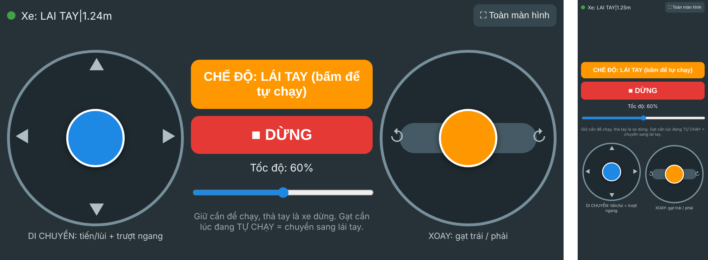
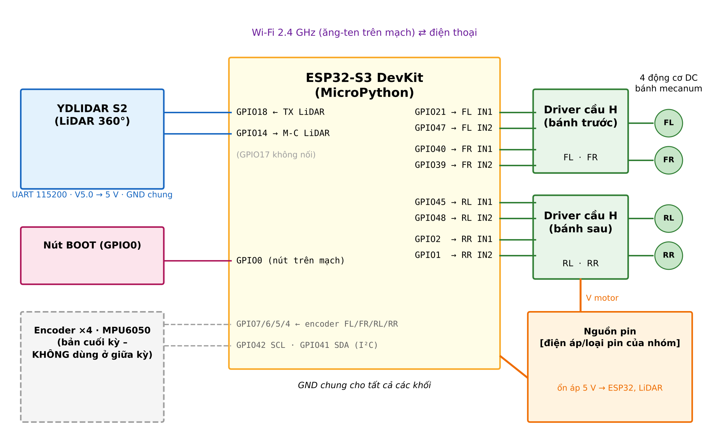
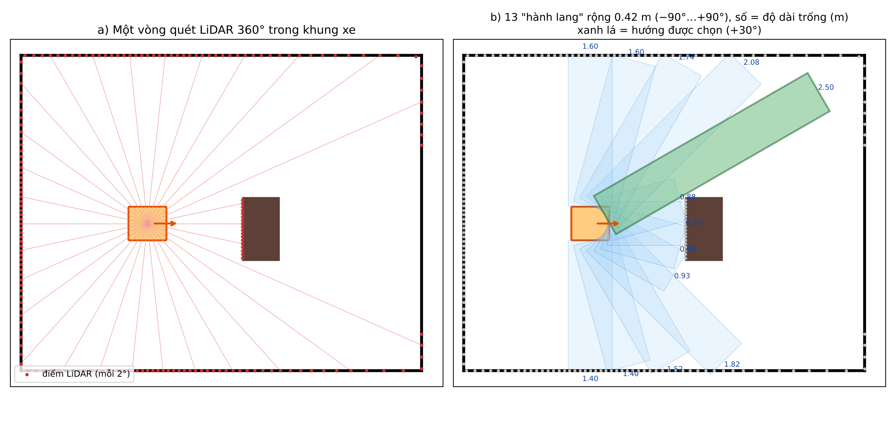
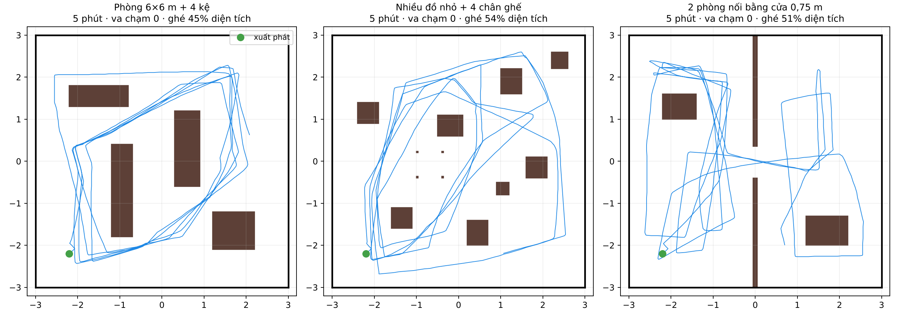

# OOMWOO – Xe mecanum tự hành tránh vật cản bằng LiDAR (bản giữa kỳ)

Xe 4 bánh mecanum dùng **ESP32-S3 + MicroPython**, có hai chế độ:

- **TỰ CHẠY**: xe đi lung tung trong phòng, tránh vật cản và tường **chỉ dựa trên LiDAR 360°** (YDLIDAR S2 / X2). Không cần encoder, MPU6050 hay máy tính.
- **LÁI TAY**: điều khiển bằng 2 joystick trên **trang web do chính ESP32 phục vụ**. Xe tự phát Wi-Fi, điện thoại vào Wi-Fi đó rồi mở `http://local.rccar`, không cần cài app.

Ở cả hai chế độ đều có **phanh an toàn** bằng LiDAR: xe không tịnh tiến về phía vật cản quá gần. Xe cũng tự dừng khi mất kết nối điện thoại hoặc mất dữ liệu LiDAR.



## Phần cứng

| Linh kiện | Ghi chú |
|---|---|
| ESP32-S3 DevKit | MicroPython |
| YDLIDAR S2 (YDS2MD-3) hoặc X2 | 360°, 0,12–8 m, UART 115200 |
| 2 driver động cơ cầu H + 4 động cơ DC giảm tốc + 4 bánh mecanum | |
| Pin + mạch ổn áp 5 V | cấp cho ESP32 và LiDAR |



| ESP32-S3 | Nối với |
|---|---|
| GPIO21 / GPIO47 | Động cơ trước-trái (FL) IN1 / IN2 |
| GPIO40 / GPIO39 | Động cơ trước-phải (FR) IN1 / IN2 |
| GPIO45 / GPIO48 | Động cơ sau-trái (RL) IN1 / IN2 |
| GPIO2 / GPIO1 | Động cơ sau-phải (RR) IN1 / IN2 |
| GPIO18 | Chân **TX** của LiDAR (LiDAR không có chân RX; GPIO17 để trống) |
| GPIO14 | Chân **M-C** của LiDAR (bật mô-tơ quét) |
| GPIO0 | Nút BOOT trên mạch: nhấn để đổi TỰ CHẠY ↔ LÁI TAY |

LiDAR: chân **V5.0** nối 5 V, **GND** nối GND chung với ESP32.

## Cấu trúc thư mục

```
esp32/                 toàn bộ file nạp lên ESP32
  main.py              vòng lặp chính: chế độ, lệnh, phanh an toàn, tự kiểm tra
  giuaky_config.py     cấu hình bản giữa kỳ: Wi-Fi xe phát, tốc độ, khoảng cách tránh vật cản
  config.py            chân GPIO, dấu bánh, LiDAR, PWM
  wander_lib.py        thuật toán tự chạy (13 "hành lang trống", trạng thái CHẠY / QUAY / THOÁT)
  kiemtra_lib.py       học tia LiDAR chạm thân xe; tự kiểm tra chiều xoay / tiến / trượt
  lidar_lib.py         giải mã gói LiDAR (AA 55, checksum, bù góc) -> 360 ô khoảng cách
  motor_lib.py         trộn mecanum, PWM, bù vùng chết, làm mượt (encoder_lib.py: motor_lib cần)
  web_lib.py           Wi-Fi AP/STA, DNS, HTTP, WebSocket (không chặn)
  web_page.py          trang điều khiển (sinh từ web/web_page.html)
  ble_lib.py           điều khiển qua Bluetooth LE (dự phòng, CONTROL = 'ble')
web/                   mã nguồn trang điều khiển + script sinh web_page.py
app/                   app Android MIT App Inventor (Bluetooth, dự phòng)
nap_esp32.sh           nạp esp32/*.py lên ESP32 rồi mở nhật ký
docs/hinh/             hình minh họa
```

## Nạp và chạy

Yêu cầu: ESP32-S3 đã cài firmware MicroPython; máy tính có Python 3.

```bash
git clone <địa chỉ repo này>
cd <thư mục repo>
./nap_esp32.sh            # tự cài mpremote nếu thiếu, nạp esp32/*.py, mở nhật ký (Ctrl+D để chạy)
./nap_esp32.sh --monitor  # chỉ xem nhật ký
```

Nhật ký sẽ in ra dòng: `XE ĐANG PHÁT Wi-Fi 'OOMWOO-XE' (mật khẩu 12345678) ... http://192.168.4.1`. Từ lần sau chỉ cần cấp điện cho xe.

**Trên điện thoại:**
1. Vào Wi-Fi **OOMWOO-XE**, mật khẩu **12345678**. Nếu máy báo "không có Internet" thì chọn giữ kết nối.
2. Mở Chrome hoặc Safari, gõ **`http://local.rccar`** (hoặc `http://192.168.4.1`).
3. Cần trái: tiến / lùi / trượt ngang / đi chéo. Cần phải: xoay. Nút **CHẾ ĐỘ** đổi TỰ CHẠY ↔ LÁI TAY, nút **■ DỪNG** để dừng.

Đổi tên hoặc mật khẩu Wi-Fi: sửa `AP_SSID`, `AP_PASS` (≥ 8 ký tự) trong `esp32/giuaky_config.py`, rồi nạp lại.

Sửa giao diện: sửa `web/web_page.html`, chạy `python3 web/gen_web_page.py`, rồi nạp lại.

## Cách hoạt động (tóm tắt)

- **LiDAR → 360 ô**: giải mã gói, kiểm tra checksum, bù góc theo khoảng cách, nội suy vào 360 ô 1° (0° = mũi xe, tăng ngược chiều kim đồng hồ).
- **Tự chạy**: mỗi vòng quét tính độ dài "hành lang trống" rộng bằng thân xe theo 13 hướng (−90°…+90°), chọn hướng thoáng nhất, cộng thêm một "sở thích" ngẫu nhiên để xe đi khắp phòng.
  - Phía trước bị chắn: xoay về một hướng thoáng chọn ngẫu nhiên.
  - Có vật sát thân xe: trượt ngang ra xa trước khi xoay.
- **Phanh an toàn**: khoảng dừng = 260 mm + 300 mm × tốc độ (m/s). Nếu có ≥ 2 tia trong nón ±40° quanh hướng đi gần hơn khoảng dừng thì xe bỏ phần tịnh tiến (vẫn cho xoay).
- **Lúc mới bật**: xe đứng yên học các tia LiDAR chạm chính thân xe (cột, dây) để bỏ qua. Lần đầu vào TỰ CHẠY, xe thử xoay / tiến / trượt ngắn để phát hiện cấu hình sai chiều (W_SIGN, VY_SIGN, LiDAR quay ngược, lắp lệch 90°/180°) và tự bù.



## Trạng thái kiểm thử

Firmware đã được kiểm thử bằng **mô phỏng phần cứng trong vòng lặp**: chạy nguyên mã MicroPython trên máy tính, nối với xe, phòng và LiDAR ảo, cùng trình duyệt Chromium thật cho phần web. Kết quả mô phỏng:

- 24 lượt tự chạy, mỗi lượt 5 phút, trong 3 kiểu phòng: không va chạm, không bị kẹt.
- 13/13 kịch bản chức năng đạt.

Kết quả trên xe thật: *(bổ sung)*.


